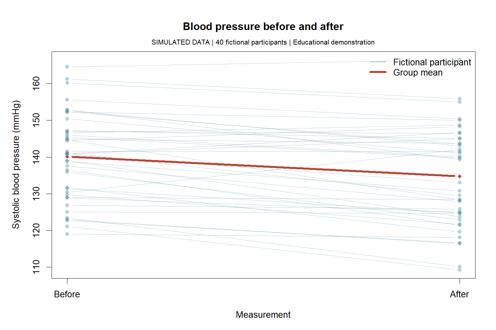
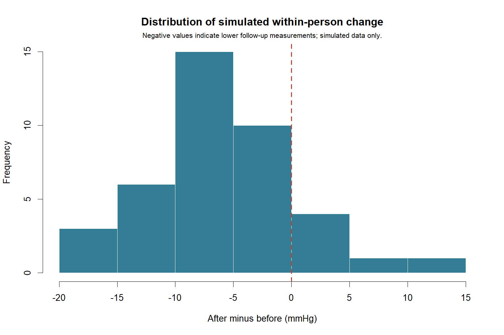

# Paired blood pressure analysis in R

An introductory R project exploring how to check, summarise and visualise paired systolic blood pressure measurements. It supports my developing interests in cardiovascular science and disease prevention.

**All data are simulated. This is a programming demonstration, not a clinical study.**

## Analysis question

How can within-person changes in systolic blood pressure be described using summary statistics and paired plots?

## Data and simulation

The script creates 40 fictional records with `set.seed(2027)`. Before values are drawn from a normal distribution with mean 138 and standard deviation 12 mmHg. After values are generated by adding a normally distributed change with mean -5 and standard deviation 6 mmHg. Measurements are rounded to one decimal place. These parameters are illustrative assumptions, not estimates from a published study. No patients were recruited and no intervention took place.

## Workflow

1. Generate the simulated data, save a CSV and import it.
2. Check the required columns, numeric types, participant IDs and missing values.
3. Calculate each change as after minus before.
4. Report the mean and sample standard deviation for each measurement and for change.
5. Create a paired plot and a histogram of individual changes.
6. Save the results and R session information.

## Results

| Measurement | n | Mean (mmHg) | SD (mmHg) |
|---|---:|---:|---:|
| Before | 40 | 140.09 | 11.78 |
| After | 40 | 134.76 | 13.63 |
| Change: after minus before | 40 | -5.33 | 6.38 |

Negative change means a lower after measurement. The difference follows from the simulation assumptions and does not demonstrate a treatment effect.





The [generated report](outputs/RESULTS.md) and [summary CSV](outputs/summary_table.csv) contain the saved results.

## Reproduce the analysis

Download and extract the repository. Open `blood-pressure-r-demo.Rproj` in RStudio, open `analysis.R` and select **Source**. Alternatively, run this command from the project directory:

```sh
Rscript --vanilla analysis.R
```

Only base R functions and packages distributed with R are used; no additional package installation is required. The live script was rerun successfully with R 4.6.2 during a reproducibility check.

The script recreates its named data and output files. Run it in a separate project folder, and do not replace the simulated CSV with real participant data. Environment details are recorded in `outputs/session_info.txt`.

## Data dictionary

| Variable | Description | Unit |
|---|---|---|
| participant_id | Fictional participant identifier | None |
| sbp_before | Simulated before measurement | mmHg |
| sbp_after | Simulated after measurement | mmHg |
| change | After minus before, derived during analysis | mmHg |

The source CSV contains the first three variables. The script derives `change` after importing it.

## Limitations

These data cannot answer a clinical question about disease prevention or treatment effectiveness. The simulation omits factors such as medication changes, measurement error, confounding and regression to the mean. Even real before-and-after observations without a comparison group would not establish causation. No hypothesis test or clinical recommendation is presented.

## Acknowledgement

The initial code and documentation were prepared with generative AI assistance. This repository is an introductory learning resource.

## Further development

A future extension could use an appropriately licensed public cardiovascular dataset, with a prespecified question, documented variables and an explicit missing-data strategy.
