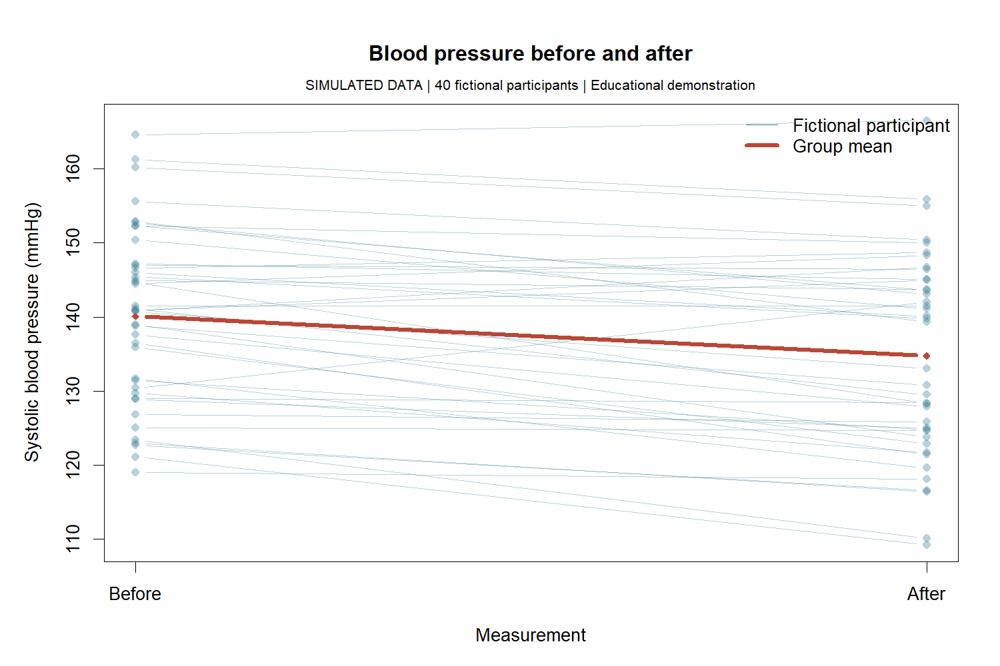
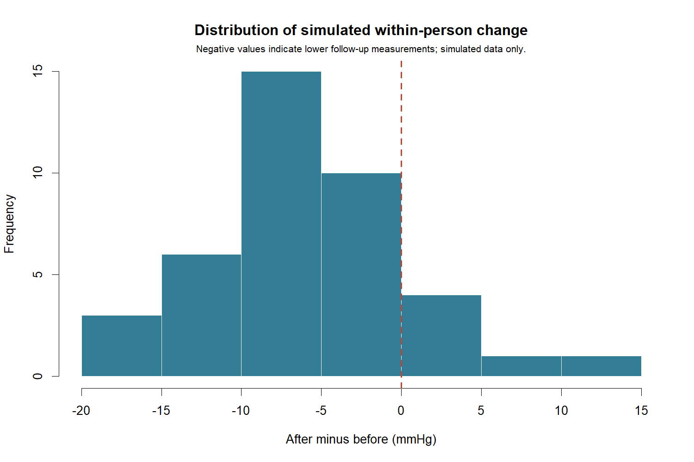

# Results: simulated blood pressure analysis

**Educational demonstration. No real participants or clinical evidence.**

| Measurement | n | Mean (mmHg) | SD (mmHg) |
|---|---:|---:|---:|
| Before | 40 | 140.09 | 11.78 |
| After | 40 | 134.76 | 13.63 |
| Change: after minus before | 40 |  -5.33 |  6.38 |

An average reduction was built into the simulation. These results reflect
that assumption and cannot establish a health benefit from exercise.

All 40 participant IDs are unique and all analysed values are non-missing.
Negative change means a lower after measurement. Individual changes vary.

No hypothesis test is used: statistical significance from invented data
would not provide evidence about a real intervention.
